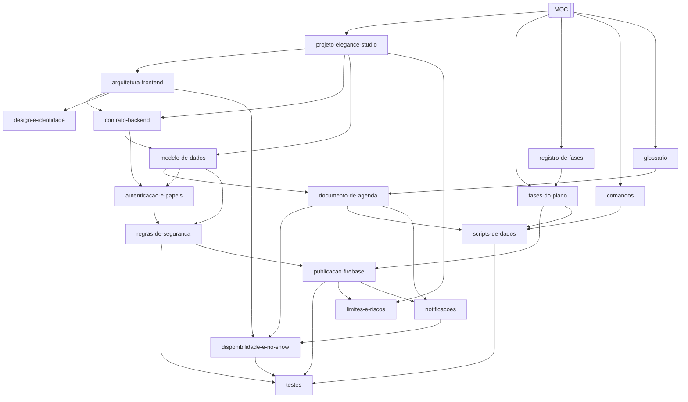

# MOC — mapa do cofre

Ponto de partida do segundo cérebro do EleganceStudio. Cada linha é um `[[wikilink]]`: no
Obsidian, esta nota é o nó mais conectado do grafo — tudo sai daqui e volta para cá.

## O grafo

## Comece por aqui

- [[projeto-elegance-studio]] — o que é o sistema e o estado atual em uma frase.
- [[fases-do-plano]] — as seis fases, com commits e o que cada uma provou.
- [[registro-de-fases]] — linha do tempo do trabalho.

## Como o sistema funciona

- [[arquitetura-frontend]] — camadas, estado, rotas, calendário.
- [[contrato-backend]] — como o app troca `localStorage` por Firestore sem mudar tela.
- [[modelo-de-dados]] — coleções, campos e papéis.
- [[documento-de-agenda]] — o cadeado que impede duas reservas no mesmo horário.
- [[disponibilidade-e-no-show]] — grade de 30 min, conflito, falta e taxa de no-show.
- [[notificacoes]] — o pedido de e-mail, os lembretes de véspera e o que falta para enviar.

## Segurança e operação

- [[autenticacao-e-papeis]] — quem é gestão e por que ninguém se promove.
- [[regras-de-seguranca]] — o que cada perfil lê e escreve.
- [[scripts-de-dados]] — seed, backfill e o Admin SDK.
- [[publicacao-firebase]] — índice composto, `deploy:rules`, checklist e o que falta.

## Qualidade e limites

- [[testes]] — 78 testes de aplicação e 23 de regra; e o que nenhum deles prova.
- [[limites-e-riscos]] — o que é estimativa, demonstração ou pendência.
- [[design-e-identidade]] — tokens, tipografia e placeholders.

## Referência

- [[comandos]] — tudo que se roda no projeto.
- [[glossario]] — MOC, wikilink, transação, backfill, no-show.

## Como manter

Nota nova entra aqui **e** em pelo menos duas outras notas (uma que a explica e uma que ela
explica). Nota sem ligação nenhuma é nota que ninguém encontra. Convenções em [[README|README do
cofre]].
